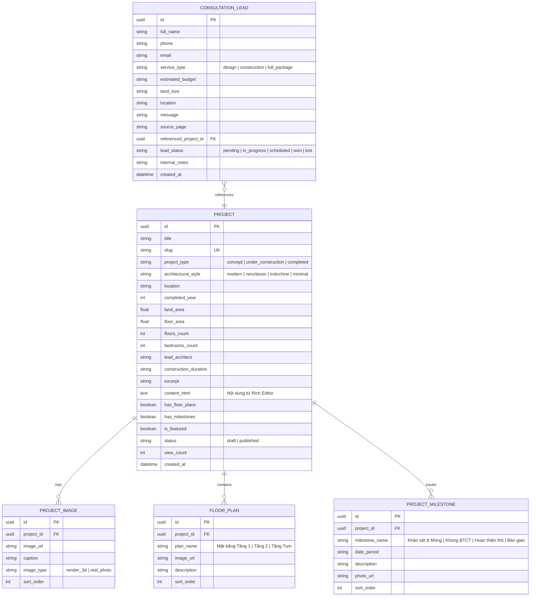

# Kế Hoạch & Đánh Giá Chi Tiết Thiết Kế Website Axhome Architecture

> **Nguồn thiết kế:** [Figma - Axhome Architecture (Key: `DSzrCfaZrm5NL29HQawzhN`)](https://www.figma.com/design/DSzrCfaZrm5NL29HQawzhN/Axhome_Architecture?node-id=0-1&m=dev&t=xeG5zefTXPQGGjfy-1)  
> **Tài liệu tham chiếu:** `architecture_construction_project_brief.md`, `.agents/rules/*.md`  
> **Ngôn ngữ hiển thị website:** Tiếng Việt  
> **Định vị thương hiệu:** *"Bản vẽ chuẩn — Tối ưu chi phí — Thi công trọn gói"*  
> **Quyết định kiến trúc đã chốt:** Hợp nhất 2 mục *"Thiết kế"* và *"Công trình"* thành một mục duy nhất: **"DỰ ÁN" (`/projects`)**, sử dụng **Modular Template** dùng chung cho trang chi tiết (`/projects/:slug`).

---

## 1. Tổng Quan Kiến Trúc Sau Khi Tinh Giản

Việc hợp nhất giúp tinh giản cấu trúc website, tối ưu trải nghiệm người dùng và giảm khối lượng code cần bảo trì:

| Khu vực    | Route                             | Mục tiêu & Nội dung                                                                                                                                                                                                  |
| :--------- | :-------------------------------- | :------------------------------------------------------------------------------------------------------------------------------------------------------------------------------------------------------------------- |
| **Public** | `/`                               | **Trang Chủ:** 9 sections (Hero banner, Floating metrics, Giới thiệu, 3 Dịch vụ, Dự án tiêu biểu, Cam kết vì sao chọn Axhome, Quy trình 6 bước, Testimonials, Form tư vấn nhanh).                                    |
| **Public** | `/about`                          | **Giới Thiệu:** Câu chuyện thương hiệu, Cột mốc phát triển, Tầm nhìn - Sứ mệnh, 4 Giá trị cốt lõi, Năng lực KTS/Kỹ sư, Quy trình làm việc.                                                                           |
| **Public** | `/projects`                       | **Dự Án (Catalogue):** Danh sách toàn bộ dự án với các tab bộ lọc: _Tất cả_, _Bản vẽ thiết kế 3D_, _Đang thi công_, _Đã hoàn thành bàn giao_. Hỗ trợ lọc theo loại hình (Biệt thự, Nhà phố, Dinh thự) và địa điểm.   |
| **Public** | `/projects/:slug`                 | **Chi Tiết Dự Án (Modular Template):** Dùng chung format cho mọi dự án. Nội dung bài viết chi tiết viết từ Editor, kèm các khối linh hoạt (Gallery, Bản vẽ mặt bằng, Nhật ký tiến độ thi công, Form đăng ký tư vấn). |
| **Public** | `/contact`                        | **Liên Hệ:** Thông tin các chi nhánh/xưởng, Form yêu cầu tư vấn chuyên sâu, Bản đồ và kết nối mạng xã hội.                                                                                                           |
| **Admin**  | `/admin/login`                    | **Đăng nhập Admin:** Giao diện đăng nhập hệ thống quản trị CMS.                                                                                                                                                     |
| **Admin**  | `/admin/dashboard`                | **Bảng điều khiển:** 4 KPI Cards, biểu đồ tương tác, danh sách Leads mới cần gọi, danh sách dự án đang thi công.                                                                                                     |
| **Admin**  | `/admin/projects`                 | **Quản Lý Dự Án (CRUD tập trung):** Danh sách, tìm kiếm, lọc theo phân loại (_Thiết kế / Thi công_), trạng thái (_Draft / Published_).                                                                               |
| **Admin**  | `/admin/projects/create` & `/:id` | **Biên tập Dự Án:** Nhập thông số kỹ thuật, tích hợp Rich Text Editor viết bài, upload Gallery ảnh, tùy chọn thêm Mặt bằng công năng hoặc Mốc tiến độ thi công.                                                      |
| **Admin**  | `/admin/contacts`                 | **CRM Quản lý Yêu Cầu Tư Vấn:** Tiếp nhận leads từ các form, quản lý pipeline xử lý (_Chờ xử lý → Đang tư vấn → Đã hẹn → Đã chốt HĐ → Đã huỷ_), lưu ghi chú nội bộ.                                                  |
| **Admin**  | `/admin/settings`                 | **Tài khoản & Bảo mật:** Quản lý hồ sơ quản trị viên, đổi mật khẩu đăng nhập Admin và giám sát trạng thái kết nối hạ tầng (Go API & Cloudflare R2). Thông tin thương hiệu & 3 dịch vụ cốt lõi giữ tĩnh ở Frontend (`0ms` độ trễ, không gọi API cấu hình). |

---

## 2. Quy Chuẩn Design System & Bố Cục Màu Sắc

Phong cách: **Warm Minimalist Architecture / Minimalist Luxury**. Màu sắc lấy cảm hứng từ vật liệu gỗ ấm, đá tự nhiên và bê tông kiến trúc.

### 2.1. Bảng màu chuẩn (Color Tokens)

```scss
// Brand Colors (Màu thương hiệu)
$color-brand-primary: #8a7159; // Nâu chính (Buttons, highlights, active nav)
$color-brand-light: #bba58c; // Nâu sáng (Hover states, badges, viền trang trí)
$color-brand-dark: #594638; // Nâu đậm (Text nhấn mạnh, icons đặc biệt)

// Surfaces & Structure (Nền & Bề mặt)
$color-surface-bg: #faf9f6; // Nền chính toàn trang (Off-white ấm)
$color-surface-card: #ffffff; // Nền card, form, modal (Trắng tinh khiết)
$color-surface-border: #e7e1d9; // Viền ngăn cách (Border mỏng thanh lịch 1px)

// Typography Colors (Văn bản)
$color-text-primary: #302c28; // Tiêu đề, chữ chính (Đen nâu than củi)
$color-text-secondary: #81776d; // Đoạn văn, nhãn phụ, thông số
$color-text-muted: #b9b0a5; // Placeholder, disabled, ghi chú nhỏ

// Semantic Status Badges (Trạng thái)
$color-status-published-bg: #ebf5ed;
$color-status-published-text: #2d6a4f;
$color-status-published-border: #c7e6cd; // Đã xuất bản
$color-status-draft-bg: #f2efea;
$color-status-draft-text: #685f56;
$color-status-draft-border: #ded8cf; // Bản nháp
$color-status-pending-bg: #fef8ec;
$color-status-pending-text: #a26b14;
$color-status-pending-border: #fce6b7; // Chờ xử lý (Leads)
$color-status-progress-bg: #eef4fa;
$color-status-progress-text: #2563eb;
$color-status-progress-border: #c9def4; // Đang thi công
$color-status-completed-bg: #ebf7ee;
$color-status-completed-text: #15803d;
$color-status-completed-border: #bbf7d0; // Hoàn thành bàn giao
$color-status-cancelled-bg: #fdf2f2;
$color-status-cancelled-text: #dc2626;
$color-status-cancelled-border: #fecaca; // Đã huỷ
```

### 2.2. Kiểu chữ (Typography)

- **Font chữ chủ đạo:** `Be Vietnam Pro` (weights: 400, 500, 600, 700) đảm bảo dấu tiếng Việt hiển thị sắc nét, sang trọng.
- **Font số liệu / kỹ thuật:** Monospace (`Liberation Mono` hoặc system monospace) cho diện tích m², kích thước, mã bản vẽ.
- **Phân cấp cỡ chữ:**
  - Page Title: `20px - 28px` / Bold
  - Section Header: `16px - 20px` / SemiBold
  - Body text: `13px - 14px` / Regular (`line-height: 1.5 - 1.6`)
  - Caption / Meta tag: `11px - 12px` / Medium

---

## 3. Kiến Trúc Trang Chi Tiết Dùng Chung (Modular Detail Template)

Tất cả các dự án sẽ sử dụng chung route `/projects/:slug` với các khối nội dung được bật/tắt linh hoạt theo dữ liệu:

```
+--------------------------------------------------------------------------+
| 1. BREADCRUMB & HEADER                                                   |
|    Trang chủ > Dự án > Tên Dự Án (Kèm Badge: Bản vẽ 3D / Đang thi công)  |
|    Meta Bar: Vị trí | Diện tích | Số tầng | Phong cách | Năm hoàn thành  |
+--------------------------------------------------------------------------+
| 2. HERO SHOWCASE                                                         |
|    Ảnh đại diện lớn (Render 3D chất lượng cao hoặc Ảnh chụp thực tế)     |
+--------------------------------------------------------------------------+
| 3. BÀI VIẾT CHI TIẾT (RENDER TỪ EDITOR ADMIN)                            |
|    Ý tưởng kiến trúc, giải pháp bố trí không gian, thách thức thi công   |
+--------------------------------------------------------------------------+
| 4. THƯ VIỆN HÌNH ẢNH (VISUAL GALLERY)                                    |
|    Lưới ảnh phối cảnh hoặc ảnh chụp thực tế có Lightbox phóng to         |
+--------------------------------------------------------------------------+
| 5. KHỐI NỘI DUNG TÙY CHỌN (OPTIONAL CONDITIONAL MODULES)                 |
|    [A] Bản vẽ mặt bằng công năng các tầng (Nếu có dữ liệu bản vẽ)        |
|    [B] Nhật ký tiến độ thi công - Milestone Timeline (Nếu là công trình) |
+--------------------------------------------------------------------------+
| 6. FORM ĐĂNG KÝ TƯ VẤN & DỰ ÁN LIÊN QUAN                                 |
|    Form "Đăng ký tư vấn phương án này" + 3 Dự án cùng phân khúc          |
+--------------------------------------------------------------------------+
```

---

## 4. Mô Hình Dữ Liệu Tinh Giản (Unified Data Schema)



---

## 5. Lộ Trình Triển Khai Chi Tiết Từng Task (Frontend First)

### Giai đoạn 1: Nền Tảng, Tokens & Dữ Liệu Tĩnh (Foundation)

- [x] **Task 1.1:** Cài đặt font chữ `Be Vietnam Pro` (weights: 400, 500, 600, 700) trong Next.js.
- [x] **Task 1.2:** Khởi tạo bộ biến Sass quy chuẩn tại `frontend/src/styles/` (`_variables.scss`, `_mixins.scss`, `_reset.scss`).
- [x] **Task 1.3:** Tạo cấu trúc dữ liệu tĩnh và Constants:
  - `src/constants/company.ts`: Thông tin liên hệ, hotline, địa chỉ, slogan, link MXH.
  - `src/constants/navigation.ts`: Cấu trúc menu điều hướng (Trang chủ, Giới thiệu, Dự án, Liên hệ).
  - `src/constants/projects.ts`: Mảng danh sách dự án mẫu đầy đủ (gồm cả dự án bản vẽ 3D và công trình thực tế đã thi công).
- [x] **Task 1.4:** Xây dựng Shared UI Components: `Button`, `Badge`, `Input`, `Select`, `Textarea`, `Modal/Lightbox`.
- [x] **Task 1.5:** Xây dựng Layout chung (`Header`, `Footer`, `MobileDrawer`).

### Giai đoạn 2: Phát Triển Public Website (Trang Tĩnh & Trang Chủ)

- [x] **Task 2.1:** **Trang Chủ (`/`)**:
  - Hero Section với Floating Metrics Ribbon (150+ Biệt thự, 100% Tiến độ, 0% Phát sinh).
  - Khối Giới thiệu & 3 Dịch vụ kiến trúc - xây dựng.
  - Khối Dự án tiêu biểu (Featured Projects Grid).
  - Khối Cam kết vì sao chọn Axhome & Quy trình 6 bước.
  - Khối Testimonials & Form đăng ký tư vấn nhanh.
- [x] **Task 2.2:** **Trang Giới Thiệu (`/about`)**:
  - Brand Story, Timeline phát triển, Tầm nhìn - Sứ mệnh, Đội ngũ KTS.
- [x] **Task 2.3:** **Trang Liên Hệ (`/contact`)**:
  - Thông tin các văn phòng, bản đồ, Form yêu cầu tư vấn chuyên sâu có validation.

### Giai đoạn 3: Phát Triển Mục "Dự Án" (Catalogue & Chi Tiết)

- [x] **Task 3.1:** **Trang Danh Sách Dự Án (`/projects`)**:
  - Bộ lọc tabs (_Tất cả / Bản vẽ thiết kế 3D / Đang thi công / Đã hoàn thành_).
  - Bộ lọc thứ cấp theo phong cách & loại hình, ô tìm kiếm, phân trang.
  - Lưới thẻ dự án (Project Card hiển thị hình ảnh, nhãn trạng thái, diện tích, quy mô).
- [x] **Task 3.2:** **Trang Chi Tiết Dự Án (`/projects/:slug`)**:
  - Header & Meta Bar thông số kiến trúc.
  - Hero showcase hình ảnh lớn.
  - Khối nội dung bài viết chi tiết.
  - Thư viện ảnh (Visual Gallery có lightbox).
  - Khối tùy chọn: Mặt bằng công năng (Floor Plans).
  - Khối tùy chọn: Nhật ký tiến độ thi công (Milestone Timeline).
  - Form CTA nhận tư vấn phương án này & 3 Dự án liên quan.

### Giai đoạn 4: Phát Triển UI Admin CMS (Mock Data / Frontend First)

- [x] **Task 4.1:** Trang Đăng nhập Admin (`/admin/login`) & Admin Layout (Sidebar, Topbar, User menu, Responsive Drawer).
- [x] **Task 4.2:** Dashboard (`/admin/dashboard`): 4 KPI Cards, biểu đồ/thống kê tổng quan, danh sách Leads mới cần gọi, danh sách dự án đang thi công (dùng mock data).
- [x] **Task 4.3:** Quản lý Dự án (`/admin/projects`): Bảng danh sách, tìm kiếm, phân trang, lọc theo phân loại (*Bản vẽ 3D / Đang thi công / Đã hoàn thành*) & trạng thái (*Draft / Published*).
- [x] **Task 4.4:** Tạo/Sửa Dự án (`/admin/projects/create`, `/admin/projects/[id]`): Form thông số kỹ thuật, tích hợp Rich Text Editor, upload/preview Gallery ảnh, builder Mặt bằng công năng & Mốc tiến độ thi công.
- [x] **Task 4.5:** Quản lý Yêu cầu Tư vấn (`/admin/contacts`): Pipeline CRM quản lý trạng thái khách hàng (*Chờ xử lý → Đang tư vấn → Đã hẹn → Đã chốt HĐ → Đã huỷ*) và ghi chú nội bộ.
- [x] **Task 4.6:** Tài khoản & Bảo mật Admin (`/admin/settings`): Quản lý hồ sơ quản trị viên, đổi mật khẩu đăng nhập và theo dõi trạng thái hạ tầng (lược bỏ cấu hình web động & quản lý dịch vụ để giữ tốc độ tải trang Public tĩnh 0ms không chớp).

### Giai đoạn 5: Xây Dựng Backend, Database & Ghép API (Integration)

- [x] **Task 5.1:** Thiết kế Database PostgreSQL với schema tinh giản (`projects`, `project_images`, `floor_plans`, `project_milestones`, `consultation_leads`, `users`).
- [x] **Task 5.2:** Xây dựng Go Backend REST API cho Public & Admin (JWT/Cookie Auth, Đổi mật khẩu Admin, CRUD Projects, Quản lý Leads, Upload ảnh tối ưu WebP lên **Cloudflare R2**).
- [x] **Task 5.3:** Tích hợp API vào Frontend (`src/apis/`, `src/hooks/` với Axios & TanStack Query): Thay thế toàn bộ mock data Dự án & Yêu cầu tư vấn bằng dữ liệu thật từ Backend, kết nối Auth guard và Upload ảnh Cloudflare R2.

### Giai đoạn 6: Tối Ưu Core Web Vitals, SEO, GA4 & Kiểm Thử

- [x] **Task 6.1:** Kiểm thử Responsive toàn diện (Desktop 1280px/1440px, Tablet 768px/1024px, Mobile 375px/390px/430px) cho cả Public và Admin.
- [x] **Task 6.2:** Cấu hình SEO On-page: Metadata, OpenGraph, `sitemap.ts`, `robots.ts`, JSON-LD Schema (`ArchitecturalService`, `LocalBusiness`).
- [x] **Task 6.3:** Tối ưu điểm **Core Web Vitals** (đo bằng Lighthouse & Google PageSpeed Insights mục tiêu ≥ 90+): tối ưu **LCP** (Hero image `priority`, WebP/AVIF, `sizes`), **CLS** (cố định `aspect-ratio`, font `swap`), **INP** (`next/dynamic` lazy-load các module nặng) và Cache-Control headers.
- [x] **Task 6.4:** Tích hợp **Google Analytics 4 (`@next/third-parties/google`)**: gắn `<GoogleAnalytics />` có điều kiện theo `NEXT_PUBLIC_GA_ID`, theo dõi các sự kiện chuyển đổi (`generate_lead`, `view_project`, `click_contact`).
- [x] **Task 6.5:** Kiểm tra linting Biome, TypeScript compile (`tsc --noEmit`), `next build` và chạy Lighthouse Audit kiểm chứng điểm số.

### Giai đoạn 7: Cấu Hình Deploy Miễn Phí (0đ/tháng) & Tách Biệt Dev / Production

- [x] **Task 7.1:** Nâng cấp `backend/config/config.go` hỗ trợ `DATABASE_URL` (Production Neon/Supabase) song song `DB_HOST/...` (Local Dev), tự động nhận biến `PORT` của Render/Koyeb, và tạo `backend/.env.example`, `frontend/.env.example`.
- [x] **Task 7.2:** Tạo `backend/Dockerfile` (multi-stage build gọn nhẹ ~15MB) và `backend/render.yaml` để deploy Go Backend lên Render / Koyeb Free Tier.
- [x] **Task 7.3:** Cấu hình `frontend/next.config.ts` (`images.remotePatterns` cho Cloudflare R2) và hoàn thiện deploy thực tế theo hướng dẫn `docs/DEPLOY_GUIDE.md` (Vercel + Render/Koyeb + Neon/Supabase + Cloudflare R2 + UptimeRobot).
